<h1 align="center">Rentzone on AWS — GitHub Actions, Terraform, ECS Fargate</h1>

<p align="center">
  
</p>

A vehicle-rental application on AWS. Terraform builds a two-AZ VPC. ECS Fargate runs behind an Application Load Balancer. Two GitHub Actions workflows gate delivery. TLS terminates on the load balancer. The tasks and RDS MySQL have no public address. Users reach the application only through the load balancer.

Infrastructure is applied locally. GitHub Actions never plans or applies Terraform. The pipeline reads remote state, builds and scans the image, runs Flyway when SQL changes, and rolls the Fargate service.

This repository is the write-up and the screenshots. The Terraform, the Laravel application, and the workflows stay in a private repository.

<p align="center">
  <a href="https://aws.amazon.com/"></a>
  <a href="https://www.terraform.io/"></a>
  <a href="https://github.com/features/actions"></a>
  <a href="https://aws.amazon.com/ecr/"></a>
  <a href="https://aws.amazon.com/ecs/"></a>
</p>

| Area | Detail |
| --- | --- |
| **Region** | `us-east-1` |
| **Network** | VPC `10.0.0.0/16` · two Availability Zones · two NAT Gateways |
| **Delivery** | `open-pr.yml` on feature branches · `deploy.yml` on merge to `main` · OIDC role `rentzone-dev-github-actions` |
| **Runtime** | ALB (ACM) · ECS Fargate (`desired_count = 2`) · RDS MySQL 8.4 (`app-db`, private) |
| **Secrets** | Secrets Manager · no AWS keys in GitHub |
| **IaC** | Bootstrap stack (S3 + DynamoDB lock) · app stack (remote state) |
| **Site** | `https://simsoliver.com` · `https://www.simsoliver.com` |
| **Status** | Not deployed. The screenshots are from the last working run. Apply and teardown notes stay in the private repository. |

---

## Contents

1. [Overview](#overview)
2. [Architecture](#architecture)
3. [Design choices](#design-choices)
4. [Repository layout](#repository-layout)
5. [CI/CD](#cicd)
6. [Flyway runner and ECR](#flyway-runner-and-ecr)
7. [Task definitions and Fargate service](#task-definitions-and-fargate-service)
8. [Remote state](#remote-state)
9. [Application](#application)
10. [Security snapshot](#security-snapshot)
11. [Operations](#operations)

---

## Overview

The workload is a Laravel Blade application (PHP 7.4): public booking for cars, bikes, and motorcycles, plus an `/admin` panel. Checkout is payment on pickup. One container image serves the site. The ECS service is set to two tasks.

| Practice | Implementation |
| --- | --- |
| Repeatable infrastructure | Two Terraform stacks, S3 state, DynamoDB lock, applied locally from `environments/dev` |
| Gated delivery | Pull-request checks, then Trivy before the image is pushed to ECR |
| Least privilege | Private subnets, security-group pairing, GitHub OIDC, Secrets Manager |
| Safe rollout | New task definition (image URI only) · circuit breaker · `GET /` after stable |
| Operable teardown | Local destroy runbook, kept in the private repository |

---

## Architecture

<table>
  <tr>
    <td align="center">
      <p align="center"><b>Platform architecture</b></p>
      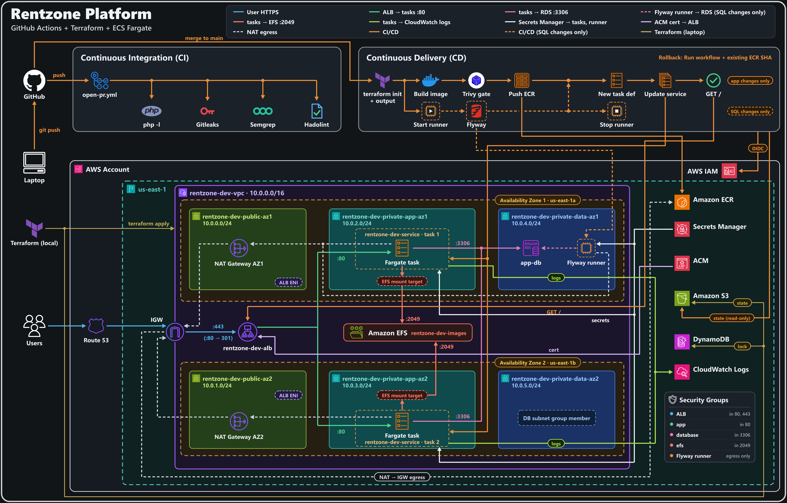
      <br><sub><b>Figure 1.</b> Region us-east-1 · VPC 10.0.0.0/16 · two Availability Zones · tasks reach EFS on port 2049 · GitHub Actions never applies Terraform.</sub>
    </td>
  </tr>
</table>

| Layer | What runs | Network |
| --- | --- | --- |
| Edge | Application Load Balancer | Public subnets · HTTPS `:443` (ACM) · HTTP `:80` redirects to 443 |
| App | ECS Fargate · `rentzone-dev-service` | Private app subnets · HTTP `:80` from the ALB only |
| Data | RDS MySQL 8.4 · identifier `app-db` | Private data subnets · `:3306` from the app SG and the Flyway runner SG |
| Photos | EFS | Private app subnets · NFS `:2049` from the app SG · mounted at `/var/www/html/public/images` |
| Migrate | Short-lived EC2 GitHub runner | Private data AZ1 · Flyway only when `rentzone-platform/sql/` changes |
| Registry | ECR `rentzone-app` | Immutable SHA tags · scan on push |

Private subnets use a NAT gateway in each Availability Zone for image pulls and other outbound calls. Users connect only to the load balancer.

### Runtime path

```
User  →  Route 53 (simsoliver.com / www)
      →  ALB :443  (TLS terminates here — ACM cert)
      →  Fargate :80  (Apache + Laravel)
            →  RDS MySQL :3306
            →  EFS :2049  (/var/www/html/public/images)
```

### Pipeline path

```
Feature branch  →  open-pr.yml  (php -l, PHPUnit, Gitleaks, Semgrep, Hadolint)
Merge to main   →  deploy.yml
      →  terraform init + output  (no apply)
      →  docker build · Trivy · push SHA to ECR
      →  Flyway on private EC2  (SQL changes only)
      →  register task definition · update service · GET /
```

### Application services

Rentzone is one PHP process. The boxes are in-process modules, not separate services.

<table>
  <tr>
    <td align="center">
      <p align="center"><b>Service architecture</b></p>
      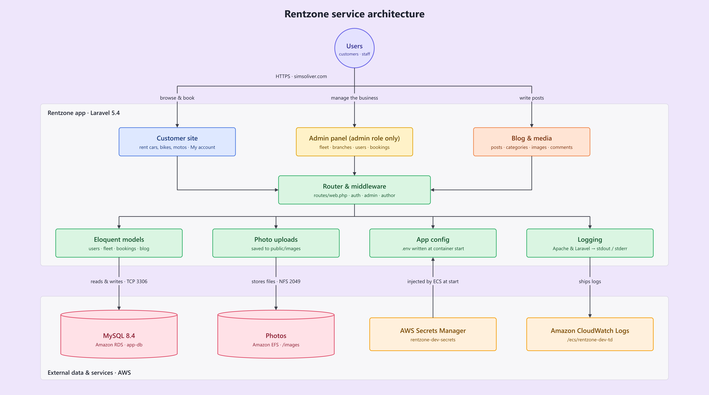
      <br><sub><b>Figure 2.</b> One Laravel app. Customers, admins, and authors share the router. Models use MySQL, uploads go to EFS, config comes from Secrets Manager, and logs go to CloudWatch.</sub>
    </td>
  </tr>
</table>

---

## Design choices

**GitHub Actions never applies Terraform.** The pipeline reads `terraform output` from existing remote state. Infrastructure changes stay on a reviewed local plan.

**OIDC instead of access keys.** `deploy.yml` assumes `rentzone-dev-github-actions`. RDS username, password, database name, and `APP_KEY` live in Secrets Manager. They are not GitHub secrets and are not baked into the image.

**Immutable image tags.** ECR mutability is `IMMUTABLE`. Each release is the git SHA. Rollback is a workflow dispatch of an existing tag — no rebuild.

**Flyway only when SQL changes.** The self-hosted runner starts in the private data subnet so it can reach RDS. Application-only merges skip that path.

**TLS on the ALB, HTTP on the task.** ACM holds `simsoliver.com` and `*.simsoliver.com`. The ALB decrypts `:443` and forwards `:80` to Fargate.

**Photos on EFS.** Every task mounts the same access point at `/var/www/html/public/images`. RDS stores the filename only.

---

## Repository layout

The private repository is laid out like this.

```
.
├── .github/workflows/
│   ├── open-pr.yml          # feature branch → PR gates
│   └── deploy.yml           # merge to main → image, Flyway, ECS
├── docs/
│   ├── architecture/        # platform and service diagrams
│   ├── evidence/            # screenshots from the working run
│   └── notes/               # setup, teardown, and flow notes
├── rentzone/                # Laravel application
└── rentzone-platform/
    ├── bootstrap/           # S3 state bucket + DynamoDB lock
    ├── environments/dev/    # environment composition (applied locally)
    ├── modules/             # networking, alb, ecs, rds, iam, ...
    ├── manifests/           # ECS task template + Flyway config
    ├── sql/                 # Flyway migrations
    └── Dockerfile           # context is the repository root
```

---

## CI/CD

<p align="center">
  
</p>

### Pull request — `open-pr.yml`

PHP syntax, the PHPUnit unit suite, Gitleaks, Semgrep (an ERROR finding fails the job), Hadolint, and a Composer license check. Composer audit is reported and does not fail the job: Laravel 5.4 is end of life, so those findings would block every merge. The workflow does not call AWS and does not build an image.

<table>
  <tr>
    <td align="center" width="50%">
      <p align="center"><b>PR checks running</b></p>
      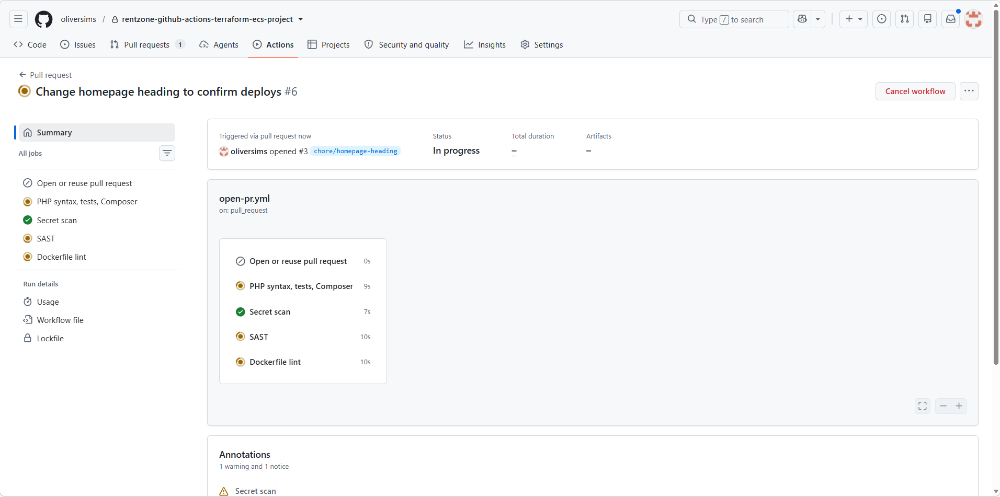
      <br><sub><b>Figure 3.</b> <code>open-pr.yml</code> on a feature-branch PR.</sub>
    </td>
    <td align="center" width="50%">
      <p align="center"><b>PR checks green</b></p>
      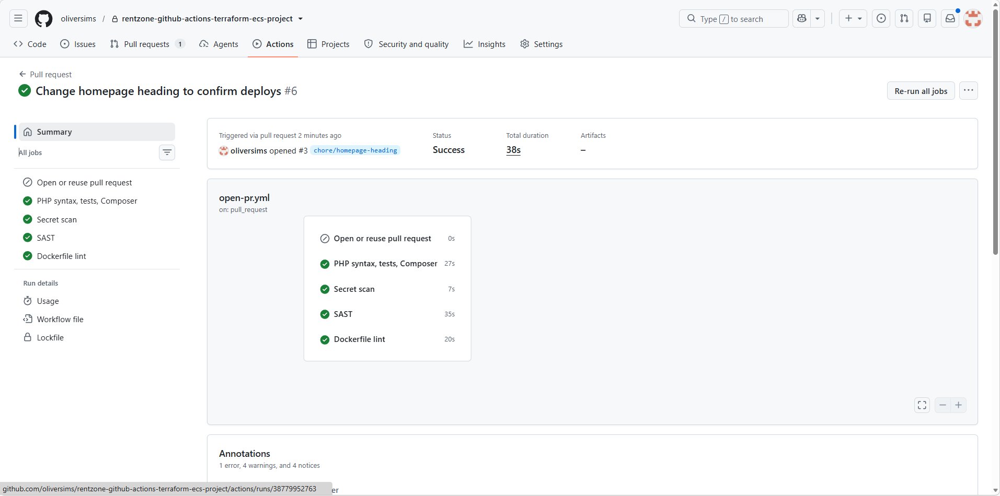
      <br><sub><b>Figure 4.</b> Syntax, Gitleaks, Semgrep, and Hadolint passed.</sub>
    </td>
  </tr>
</table>

### Deploy — `deploy.yml`

Runs on a merge to `main`, or on a manual workflow dispatch. The workflow runs `terraform init` and reads outputs. It does not apply. Trivy blocks the ECR push on a Critical finding that is not listed in `.trivyignore`. The ignored IDs are Laravel 5.4 issues this application cannot take. Flyway runs on a short-lived EC2 runner in the private data subnet, and only when SQL changed.

<table>
  <tr>
    <td align="center" width="50%">
      <p align="center"><b>Deploy graph</b></p>
      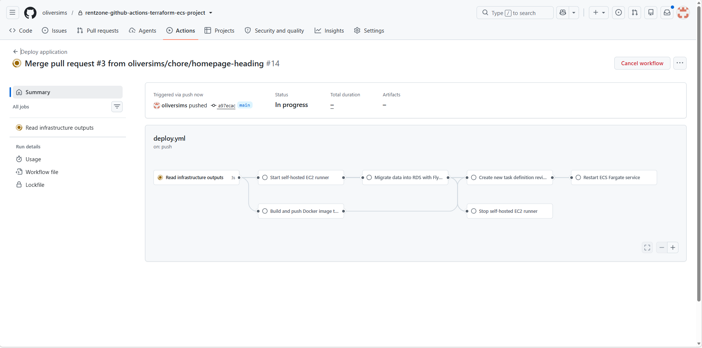
      <br><sub><b>Figure 5.</b> Image build in parallel with Flyway when SQL changed.</sub>
    </td>
    <td align="center" width="50%">
      <p align="center"><b>Deploy success</b></p>
      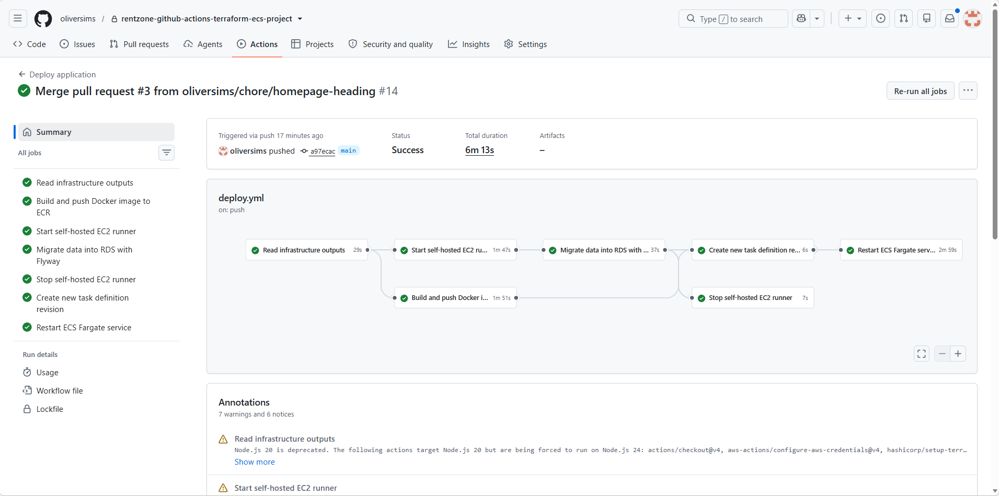
      <br><sub><b>Figure 6.</b> Push ECR · new task definition · update service · GET /.</sub>
    </td>
  </tr>
</table>

---

## Flyway runner and ECR

SQL changes start a short-lived EC2 runner in private data AZ1 so Flyway can reach RDS. The image is pushed to ECR as an immutable git SHA.

<table>
  <tr>
    <td align="center" width="50%">
      <p align="center"><b>Flyway runner</b></p>
      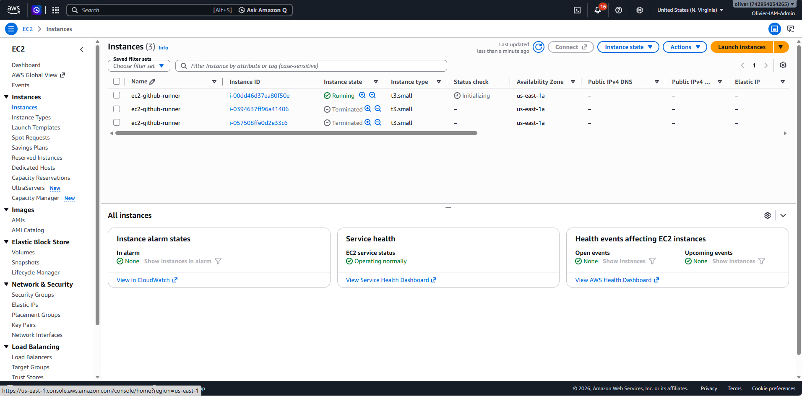
      <br><sub><b>Figure 7.</b> <code>ec2-github-runner</code> — private, terminated after migrate.</sub>
    </td>
    <td align="center" width="50%">
      <p align="center"><b>ECR</b></p>
      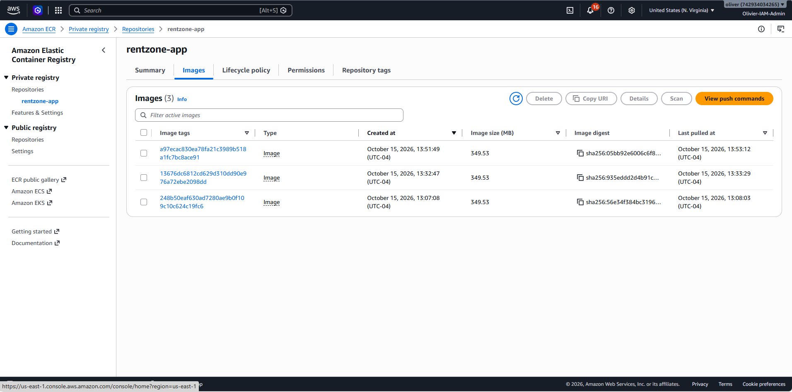
      <br><sub><b>Figure 8.</b> <code>rentzone-app</code> — immutable SHA tags, no <code>latest</code>.</sub>
    </td>
  </tr>
</table>

---

## Task definitions and Fargate service

Each deploy registers a new revision of `rentzone-dev-td` (image URI only) and points `rentzone-dev-service` at it.

<table>
  <tr>
    <td align="center" width="50%">
      <p align="center"><b>Task definitions</b></p>
      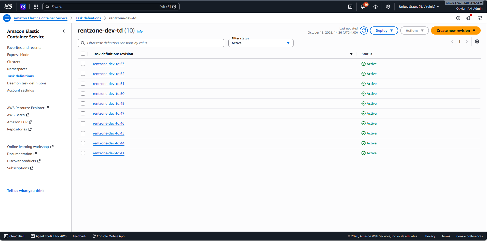
      <br><sub><b>Figure 9.</b> <code>rentzone-dev-td</code> revisions registered by deploy.</sub>
    </td>
    <td align="center" width="50%">
      <p align="center"><b>Fargate service</b></p>
      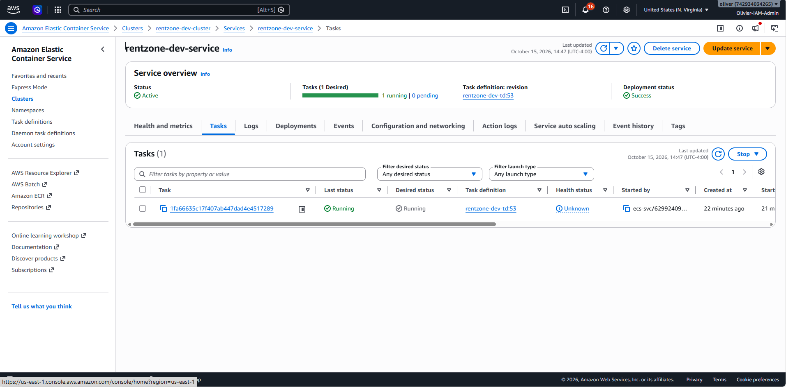
      <br><sub><b>Figure 10.</b> <code>rentzone-dev-service</code> on Fargate.</sub>
    </td>
  </tr>
</table>

---

## Remote state

The app stack stores state in S3. DynamoDB holds the lock. GitHub Actions only reads this object.

<table>
  <tr>
    <td align="center">
      <p align="center"><b>Remote state</b></p>
      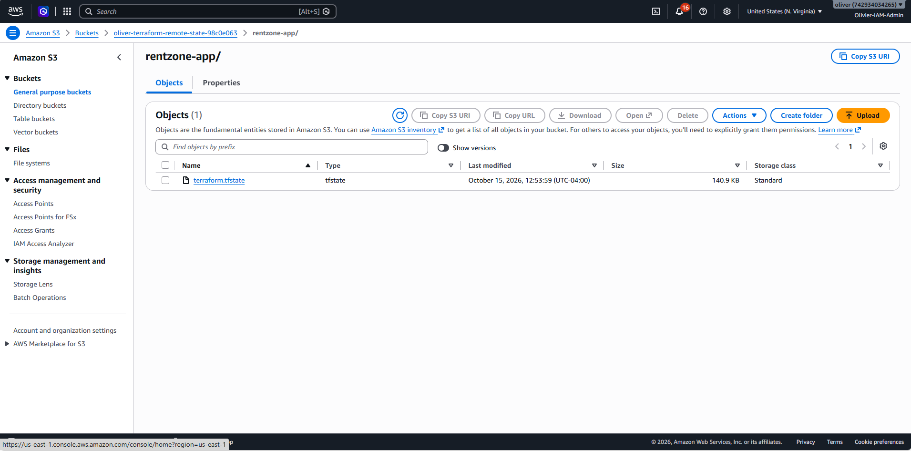
      <br><sub><b>Figure 11.</b> S3 key <code>rentzone-app/terraform.tfstate</code> · DynamoDB lock.</sub>
    </td>
  </tr>
</table>

---

## Application

Screenshots from the last deployment. TLS terminates on the load balancer. The task serves HTTP.

<table>
  <tr>
    <td align="center" colspan="2">
      <p align="center"><b>Homepage</b></p>
      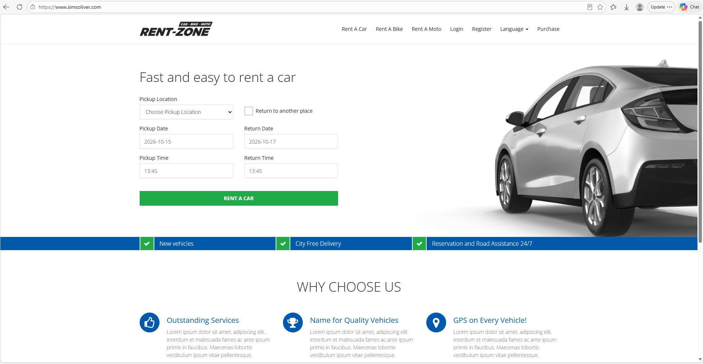
      <br><sub><b>Figure 12.</b> <code>https://simsoliver.com</code> — car search.</sub>
    </td>
  </tr>
  <tr>
    <td align="center" width="50%">
      <p align="center"><b>Login</b></p>
      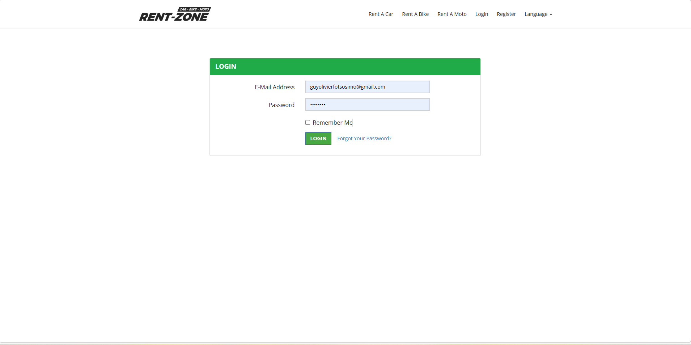
      <br><sub><b>Figure 13.</b> Public auth, then <code>/admin</code> for staff.</sub>
    </td>
    <td align="center" width="50%">
      <p align="center"><b>Choose car</b></p>
      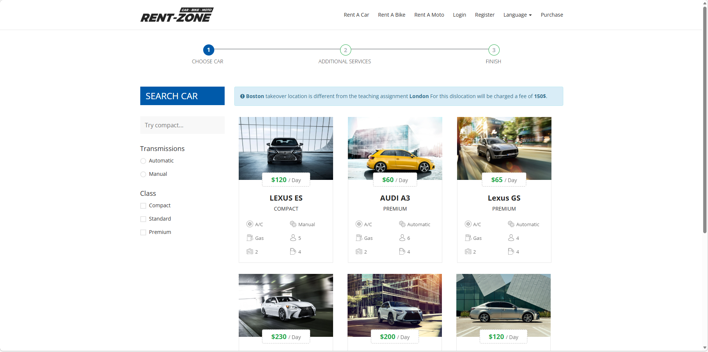
      <br><sub><b>Figure 14.</b> Catalog from RDS.</sub>
    </td>
  </tr>
  <tr>
    <td align="center" width="50%">
      <p align="center"><b>Checkout</b></p>
      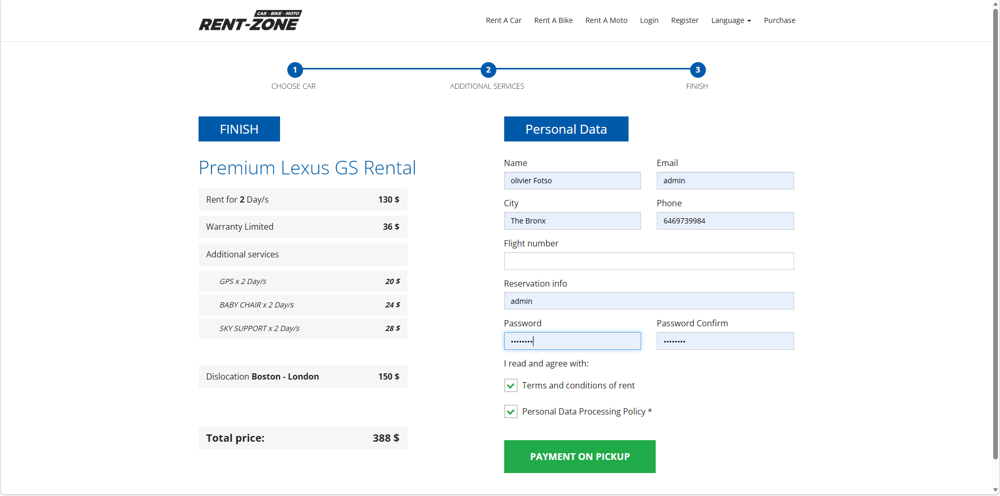
      <br><sub><b>Figure 15.</b> Payment on pickup — no card gateway.</sub>
    </td>
    <td align="center" width="50%">
      <p align="center"><b>Confirmed</b></p>
      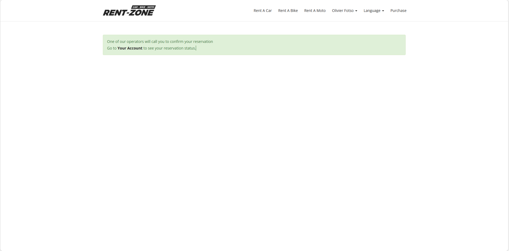
      <br><sub><b>Figure 16.</b> Reservation written to MySQL.</sub>
    </td>
  </tr>
</table>

---

## Security snapshot

| Control | Implementation |
| --- | --- |
| App HTTP | `:80` from the ALB security group only |
| MySQL | `:3306` from app SG + Flyway runner SG · `publicly_accessible = false` |
| Photos | EFS `:2049` from the app security group only |
| TLS | ACM on the ALB · HTTP 301 to HTTPS |
| Secrets | Secrets Manager · OIDC · no AWS keys in GitHub |
| Images | Immutable SHA tags · Trivy blocks unlisted Critical findings before push |
| Sessions | File sessions on the task (`SESSION_DRIVER=file`), not shared across tasks |
| State | S3 encryption, versioning, public access blocked · DynamoDB lock |
| Pull request | PHPUnit unit tests · Gitleaks · Semgrep · Hadolint · Composer license gate |

---

## Operations

```
bootstrap (S3 + lock)  →  environments/dev apply
                       →  GitHub variable AWS_ROLE_ARN
                       →  secret PERSONAL_ACCESS_TOKEN
                       →  merge to main  →  deploy.yml
```

These notes stay in the private repository.

| Document | Use |
| --- | --- |
| `FIRST-APPLY.txt` | First apply and GitHub settings |
| `DESTROY.txt` | Teardown |
| `SECURITY-PATH.txt` | Who can reach the load balancer, task, database, and photos |
| `APP-KEY.txt` | Secrets Manager → task → Laravel cookies |
| `QUALITY-AND-SECURITY-CHECKS.txt` | What must pass on a PR and on deploy |
| `PLATFORM-LAYOUT.txt` | Terraform layout and apply order |
| `GITHUB-ACTIONS.txt` | What the two workflows do |
| `WHEN-THE-PIPELINE-RUNS.txt` | When Flyway and the image build run |

The stack is not deployed. After the working run it was removed locally, so the NAT gateways, Fargate, RDS, and the load balancer would not keep running. GitHub Actions does not destroy infrastructure.

While the stack is deployed, rollback is a workflow dispatch of an existing ECR SHA. Flyway is not reversed.

---

Oliver Fotso · [github.com/oliversims](https://github.com/oliversims)
